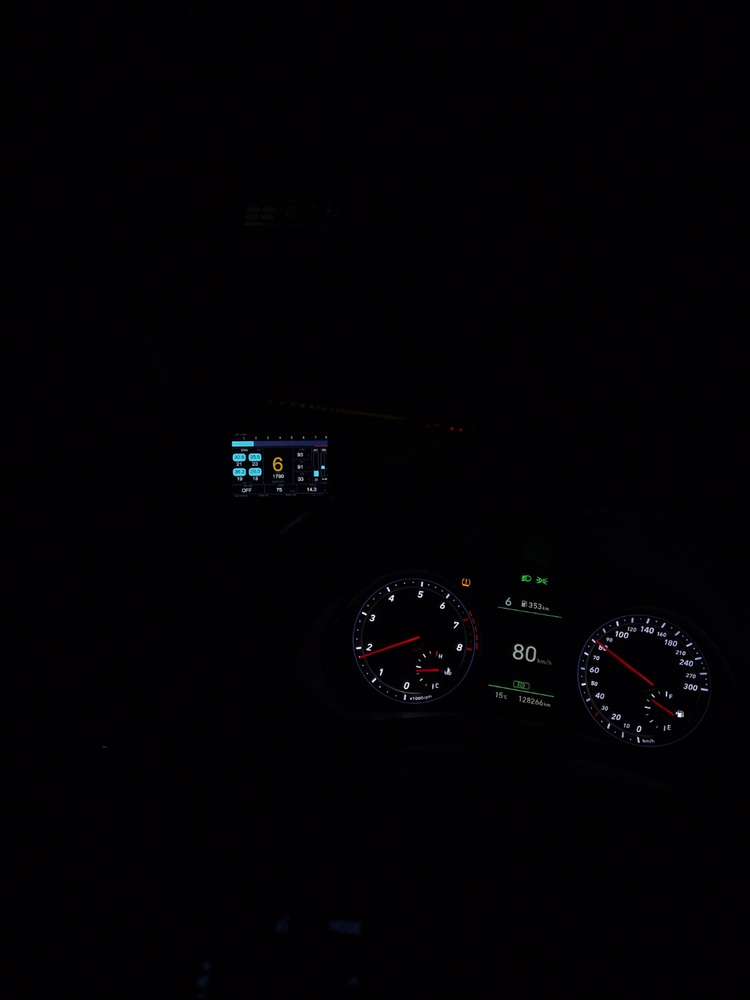
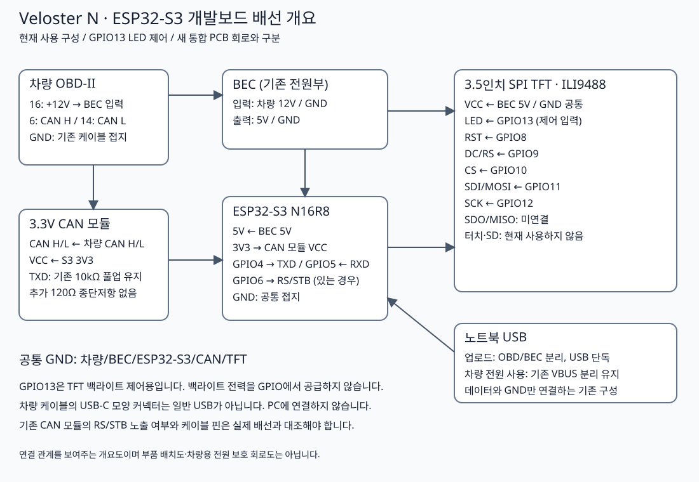

# Veloster N ESP32-S3 OBD Gauge

A DIY OBD gauge for a 2018 Hyundai Veloster N with a manual transmission. An ESP32-S3 drives a 3.5-inch ILI9488 display to show vehicle data.

## Photos and video

[Watch or download the operation video (MP4)](media/gauge-operation.mp4)

The photo and video are the original files supplied by the owner. The photo shows the central gear indicator, RPM, vehicle speed, tire pressures and temperatures, and engine-related readings. The factory speedometer and the gauge show different speeds in this photo; this alone does not establish calibration accuracy. The video is included as supplied and has not undergone frame-by-frame validation. File hashes and the video duration are listed in the [media manifest](media/manifest.json).

## Hardware

- ESP32-S3 N16R8 development board
- 3.5-inch 480 × 320 SPI TFT with an ILI9488 controller
- Existing 3.3 V CAN transceiver module
- Vehicle 12 V supply through the existing 5 V BEC regulator
- OBD CAN: 11-bit identifiers at 500 kbit/s; standard engine response ID `0x7E8`
- Active diagnostic requests; this configuration differs from the earlier RX-only logger

## Displayed data

| Reading | Implementation and limitations |
|---|---|
| RPM and vehicle speed | Combined queries for standard OBD PIDs `0C` and `0D` |
| ACC | Accelerator pedal PID normalized from raw 38–213 to 0–100%; not throttle plate position |
| REL boost | `(MAP − BARO) / 100 + 0.60` bar, with MAP and BARO in kPa. The owner-selected display offset is not a verified match to the factory boost gauge |
| Coolant, intake temperature, ECU voltage | Supported ECU readings. ECU voltage is not an independent measurement at the battery terminals |
| Oil temperature | Reference reading derived from an observed extended diagnostic response |
| Tire pressures and temperatures | Reference readings from extended TPMS responses; wheel mapping, conversion, and sensor update latency have validation limits |
| Forward gear | Estimated from the RPM-to-speed ratio; not a confirmed gear position sensor reading |
| Reverse | Based on an observed diagnostic response candidate |
| Brake | ON/OFF reference indication, not hydraulic pressure in bar |

Unconfirmed neutral, continuous clutch position, brake pressure, and driving mode data are not presented as supported features. The tire size used for gear estimation is **235/35 R19**.

## Wiring

See the [wiring notes](docs/wiring.md) for connections and power conditions. This diagram covers the current development-board assembly, not the separate integrated PCB design.

## No-sleep release

[Download v2026.11.02-nosleep-ready](https://github.com/LeeWonseok-kr/veloster-n-esp32-gauge/releases/tag/v2026.11.02-nosleep-ready) · [Source and flashing instructions](firmware/README.md)

This release removes automatic sleep and ignition wake detection. CAN acquisition runs during a 6.6-second startup sweep. The display then switches to live data once the required fields are ready, with a 15-second upper bound for unavailable readings. See the firmware instructions for the exact readiness criteria. **Disconnect power when parked: this version does not save parking battery power.** Faults and STOP still halt requests without automatic retries.

## Verification and remaining validation

Host readiness and renderer tests passed, including missing-data timeout, STOP and timer wrap. The development-board build and USB flash verification passed. The uploaded application SHA256 is `0d713dea0aa5e32fe7dcce3875a6cb477474fa65f8a4d1592917719c9ba35242`. Actual startup-to-live timing in the vehicle remains unverified for this revision. The supplied media predates this change and does not validate it. Boost, tire and temperature comparisons against factory displays retain their existing limitations.
